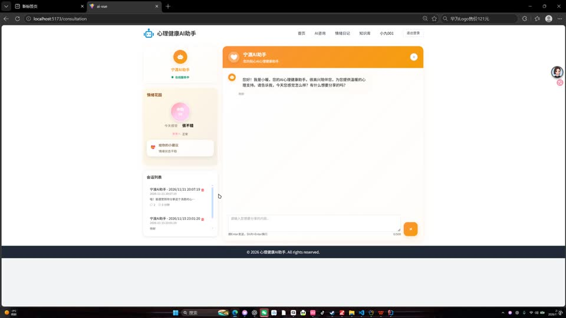
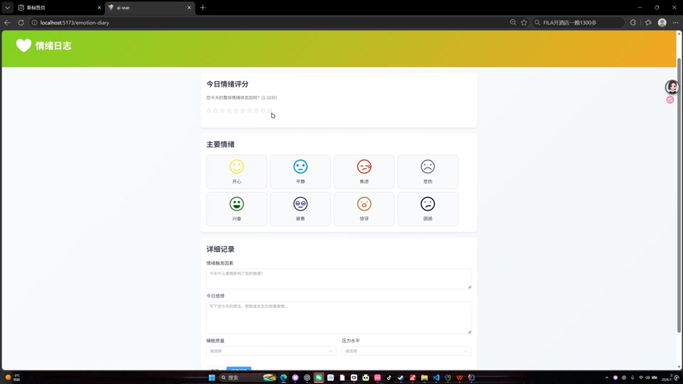
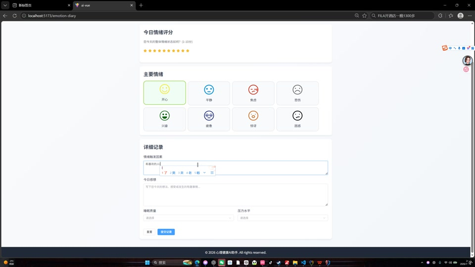

# 心理健康 AI 助手

一个面向心理健康陪伴、情绪记录和心理知识管理的前后端分离项目。项目演示视频展示了用户端 AI 咨询、情绪日记、心理知识库，以及后台咨询管理和数据分析等功能。

> **安全提示**：本项目不会在仓库中保存真实 API Key、数据库密码或 JWT 密钥。启动后端前，请通过环境变量提供本地配置。本项目仅用于技术演示和学习，不替代专业心理咨询、医疗诊断或危机干预服务。

## 项目演示

下列截图来自用户提供的演示视频，原始 MP4 未上传到仓库：

| AI 咨询 | 登录页 | 后台数据分析 |
| --- | --- | --- |
|  |  |  |

## 功能概览

### 用户端

- 首页与心理健康陪伴入口；
- AI 心理咨询会话；
- 会话列表、会话详情和情绪分析结果；
- 情绪日记记录；
- 心理健康知识库与文章详情；
- 用户注册、登录和基于 JWT 的访问控制。

### 管理端

- 管理员登录；
- 知识分类和文章管理；
- 文章封面文件上传；
- 咨询会话与消息查看；
- 情绪日记管理；
- 数据分析仪表盘。

## 技术栈

- **前端**：Vue 3、Vite、Vue Router、Pinia、Element Plus、Axios、ECharts、WangEditor；
- **后端**：Java 17、Spring Boot 3、Spring Web、Spring Security、MyBatis-Plus、Spring AI；
- **数据库**：MySQL；
- **模型服务**：通过 Spring AI 对接兼容 OpenAI API 协议的模型服务，示例配置使用 SiliconFlow 接口地址和 DeepSeek-V3 模型名。

## 目录结构

```text
.
├── code/
│   ├── ai-vue/                 # Vue 3 前端
│   └── ai-spingboot/           # Spring Boot 后端
├── database/
│   └── schema.sql              # 脱敏后的数据库结构脚本，无用户种子数据
├── docs/
│   ├── GITHUB_UPLOAD_GUIDE.md  # GitHub 上传与安全检查流程
│   └── screenshots/            # 从演示视频提取的 README 配图
└── README.md
```

## 环境要求

- Node.js 18+；
- Java 17；
- MySQL 8.x；
- 可访问的兼容 OpenAI API 协议的模型服务；
- Git。

## 本地运行

### 1. 初始化数据库

创建数据库并执行 `database/schema.sql`。该脚本只包含表结构，不包含原始项目中的用户、手机号、邮箱和测试数据。

### 2. 配置后端环境变量

进入后端目录，参考 `.env.example` 配置环境变量。Windows PowerShell 示例：

```powershell
cd code/ai-spingboot
$env:DB_URL = "jdbc:mysql://127.0.0.1:3306/mental_health_assistant?createDatabaseIfNotExist=true&useSSL=false&serverTimezone=UTC"
$env:DB_USERNAME = "root"
$env:DB_PASSWORD = "你的数据库密码"
$env:OPENAI_API_KEY = "你的模型服务 API Key"
$env:JWT_SECRET = "长度足够的随机字符串"
```

启动后端：

```powershell
.\mvnw.cmd spring-boot:run
```

后端默认端口为 `1236`。

### 3. 启动前端

```powershell
cd code/ai-vue
npm install
npm run dev
```

前端默认使用 Vite 开发服务器，通常为 `http://localhost:5173`。前端请求通过 `/api` 访问后端，具体代理配置以 `vite.config.js` 为准。

### 4. 构建验证

```powershell
cd code/ai-vue
npm run build

cd ../ai-spingboot
.\mvnw.cmd test
```

## 配置说明

后端配置文件：`code/ai-spingboot/src/main/resources/application.yml`。

以下配置必须通过环境变量提供：

| 环境变量 | 用途 |
| --- | --- |
| `DB_URL` | MySQL 连接地址 |
| `DB_USERNAME` | 数据库用户名 |
| `DB_PASSWORD` | 数据库密码 |
| `OPENAI_API_KEY` | 模型服务 API Key |
| `JWT_SECRET` | JWT 签名密钥 |

## 安全与隐私

- 不要提交真实 `.env` 文件、API Key、数据库密码或 JWT 密钥；
- 不要上传原始用户数据、联系方式、密码哈希或生产数据库备份；
- 不要上传 `node_modules`、`target`、`dist`、IDE 配置、日志、安装包和破解工具；
- 如果密钥已经公开过，应立即在服务商后台撤销并重新生成。

## GitHub 上传

详细流程见 [`docs/GITHUB_UPLOAD_GUIDE.md`](docs/GITHUB_UPLOAD_GUIDE.md)。

远程仓库：`https://github.com/Zlove583/AI-.git`
